# Beat the Clock: how-to guide

Balance Tri Club's prediction race. You call your finish time. You run it. Whoever lands closest to their own call wins. Speed counts for nothing.

This guide has two parts:

- **[Part 1: Sign-up](#part-1-sign-up)** is for racers and whoever holds the sign-up phone.
- **[Part 2: Admin dashboard](#part-2-admin-dashboard)** is for whoever runs the day.

| Page | Address | Who uses it |
|---|---|---|
| Sign-up | `https://jthoyer.github.io/BalanceBolt/` | Racers, on a phone passed around |
| Admin | `https://jthoyer.github.io/BalanceBolt/admin.html` | The person running the day |
| Race control | `https://jthoyer.github.io/BalanceBolt/boltresults.html` | Whoever is timing, and the screen everyone crowds round |

The screenshots show a practice race with made-up names.

---

## Part 1: Sign-up

You need about 30 seconds and a time in your head.

### 1. Open the sign-up page

Open the sign-up address on any phone. The page shows which race you are entering ("Race 1 of 5") and how many people are already on the start list.

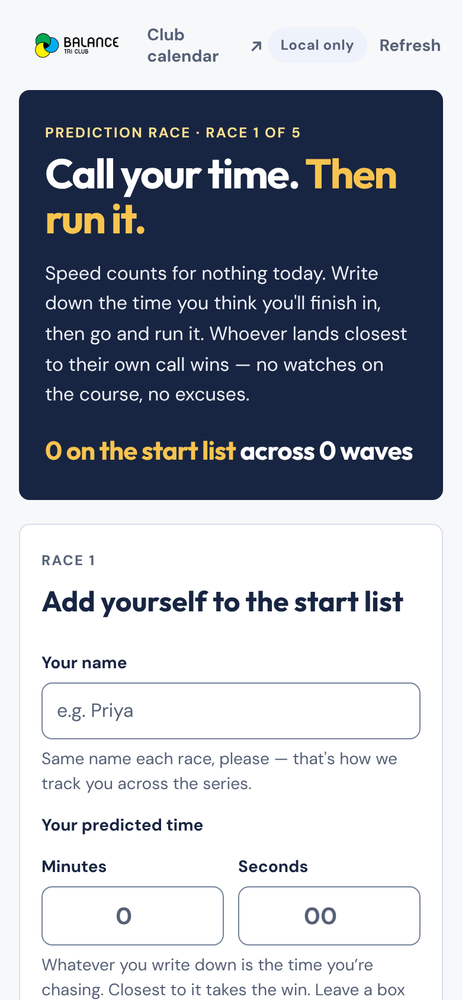

> **Which race am I entering?** The page shows whichever race the organiser has set. You cannot switch races from here. If it shows the wrong race, tell the organiser.

### 2. Type your name

Use the same name every race. That is how the app tracks you across the series. `Ada`, ` ada ` and `ADA` count as one person.

Two people with the same first name? Add a surname or a nickname.

### 3. Call your time

Enter the time you think you will take, in **minutes** and **seconds**.

- A flat 25 minutes? Type `25` in Minutes. Leave Seconds empty. An empty box counts as zero.
- Minutes can go up to 599. Seconds can go up to 59.

Whatever you write is the time you chase. Pick it carefully.

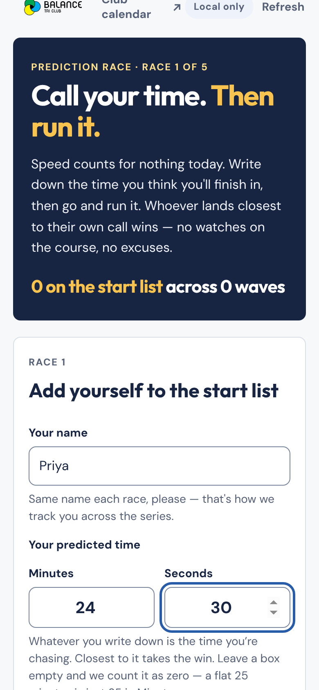

### 4. Tap "Add me to the race"

A green card confirms you are in. It gives you three things:

- your **racer number**, counted within this race (1, 2, 3…)
- your **wave**
- the time you called

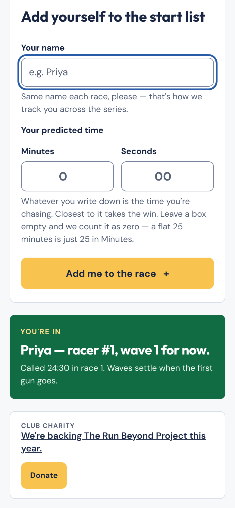

Note the words **"for now"**. Waves regroup as people sign up. They lock when the first wave starts. If you sign up after that, you join the next wave still waiting on the line.

### 5. Check the start list

Scroll down to see every wave and who is in it. Each wave shows the range of calls it covers, so you can see why you landed where you did.

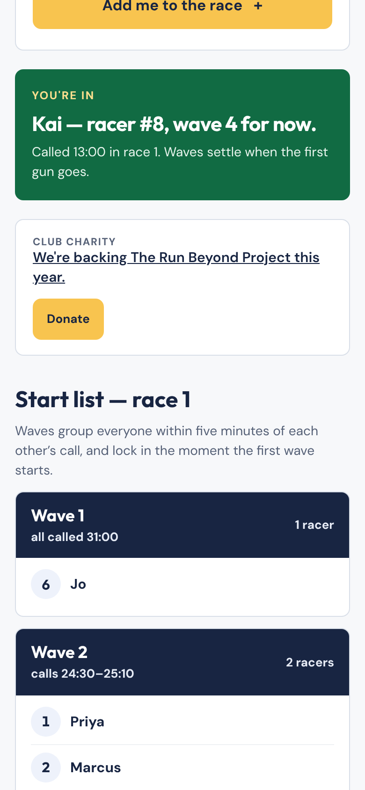

### How waves work

- People whose calls sit within **five minutes** of each other share a wave.
- **Wave 1 holds the slowest calls.** The last wave holds the quickest. Waves leave in number order and everyone comes home together.
- There are never more than six waves. If the field spreads wider, the closest groups merge.
- The start list is read-only. Nobody can remove a name from the sign-up phone. Ask the organiser.

### If something goes wrong

The form tells you what to fix. These are the messages you may see.

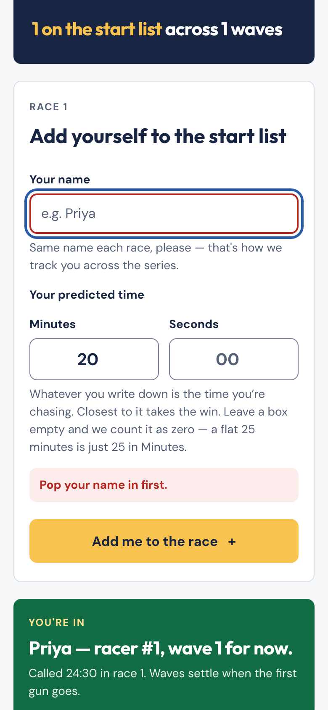

| You see | What it means | What to do |
|---|---|---|
| "Pop your name in first." | The name box is empty. | Type your name. |
| "Give us a predicted time — even a rough one." | Both time boxes are empty. | Enter minutes, seconds, or both. |
| "Nought is not a time. What are you chasing?" | Your time adds up to zero, for example `0` in Minutes and nothing in Seconds. | Enter a real time. |
| "Minutes needs to be a whole number between 0 and 599." | The minutes box has a decimal or an out-of-range number. | Use whole numbers only. |
| "Seconds needs to be a whole number between 0 and 59." | Same, for seconds. | Use 0 to 59. |
| "*Name* is already on the start list for race *N*." | Someone already signed up with that name. | Add a surname or nickname. |

Typed the wrong time? Tell the organiser. They can fix it from race control (see [Edit a racer](#edit-a-racer)).

---

## Part 2: Admin dashboard

You run the day. You have three jobs: set up, start the waves and stop the clocks, then hand out prizes.

### The admin page

Open `admin.html`. It has one job: send you to the right page. It has two buttons.

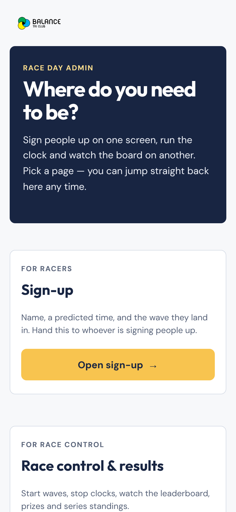

| Button | Where it goes | Use it for |
|---|---|---|
| **Open sign-up** | `index.html` | Handing a phone to whoever signs people up |
| **Open race control** | `boltresults.html` | Starting waves, stopping clocks, results, series |

The sign-up page and race control do not link to each other. That is on purpose. A phone passed around the sign-up table cannot reach race control. This page is the only way between them.

### Before race day

1. **Connect the Google Sheet.** Without it, the app stores everything in one browser on one device. Closing the browser or swapping phones loses it. The top-right pill tells you the state. Aim for **Synced**. Other states: *Local only* (no sheet connected), *Saving 2…* (sending), *Offline — 2 to send* (waiting for signal), *Sheet unreachable*, and *Not saving on this device* (the browser is blocking storage, so switch browsers). Setup steps are in `README.md` under "Connecting the Google Sheet".
2. **Pick the race.** Open race control and tap **1** to **5** under "Which race". The choice sticks to that device and appears in the address as `?race=2`. Sign-up follows whichever race is set on its device. Set the race first, then hand out the sign-up phone.
3. **Pick one timing device.** Start waves and stop clocks from the same phone. See [Timing tips](#timing-tips).

### Race control

Open race control from the admin page. The bottom bar has three tabs: **Timing**, **Results** and **Series**.

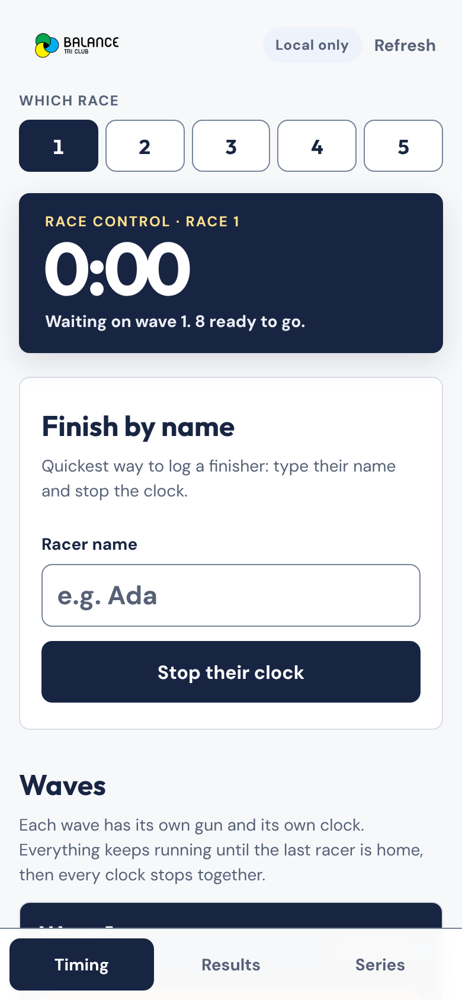

The dark panel at the top is the **race clock**. It starts at the first gun. It stays stuck to the top of the screen as you scroll.

#### Start the waves

Scroll to **Waves**. Each wave has its own card, its own clock and its own start button.

1. Tap **Start wave 1** when the gun goes. Confirm the pop-up. The clock begins at once.
2. The other waves now show a **target start**. It is the time that brings each wave home with wave 1.
3. When a target reaches zero, it says **Start now**. The app never starts a wave for you. Tap **Start wave N** yourself.
4. Need to go early or late? Tap **−30s** or **+30s**. The nudge moves that one wave only. It goes to the sheet, so every phone counts down to the same time. If two phones nudge at once, the last one to reach the sheet wins.

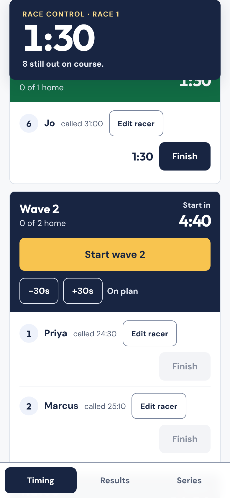

#### Stop each racer's clock

Stop each racer as they cross the line. Two ways:

- **Tap Finish** on their row.
- **Finish by name.** Type their name in the box at the top and tap **Stop their clock**. This is the quickest option in a crowd.

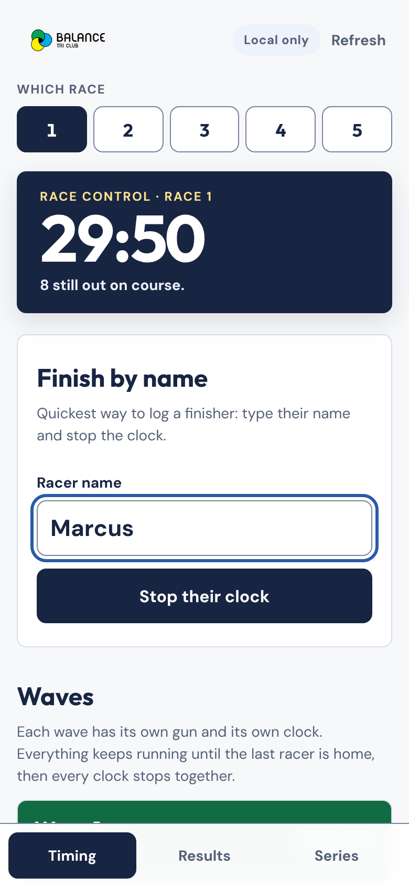

A finished row shows the racer's time, how far over or under their call they were, and an **Undo** button. Undo puts them back out on the course.

When the last racer is home, the race clock and every wave clock stop together. Undo a finish and they all start again.

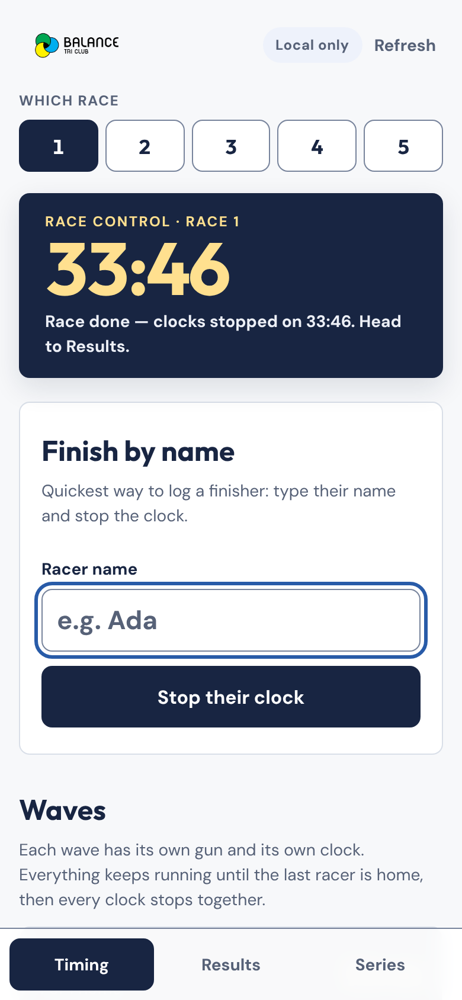

#### Edit a racer

Tap **Edit racer** on any row. One panel opens.

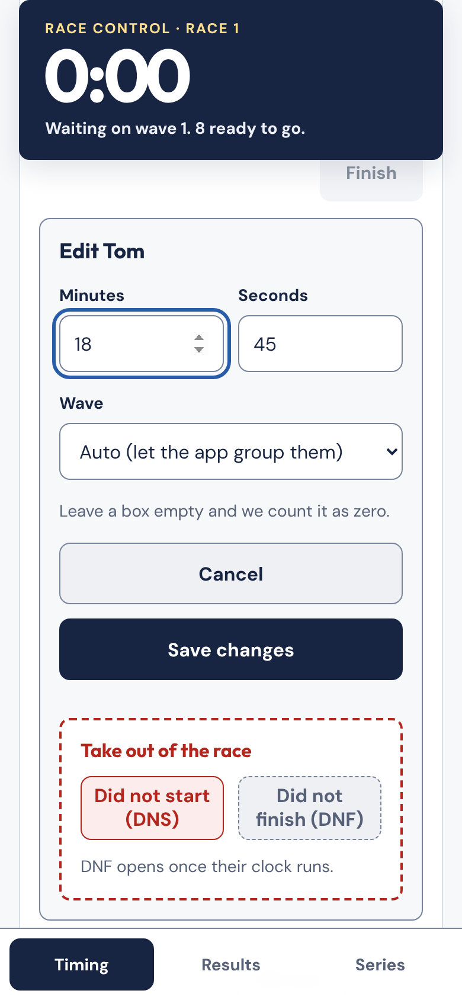

- **Fix a mistyped call.** Change Minutes and Seconds.
- **Move them to another wave.** Pick wave 1 to 6, or leave **Auto** and let the app group them.
- Tap **Save changes**.

Before the first gun, a changed call regroups the whole field. After the gun, waves are locked. Only the time they are measured against changes. That is how you correct a result after the race. A racer you moved by hand stays where you put them. **Auto** hands them back to the app.

#### Take someone out

The same panel has a red **Take out of the race** zone.

- **DNS (did not start)** works before the racer's wave starts.
- **DNF (did not finish)** works once their wave is running. You can add a reason.

Both ask you to confirm. The row then shows a red tag and a **Put back** button. Put back reverses it. A racer who is out has no result and does not hold the race clock open.

> **Before you use DNS or DNF on a shared sheet,** paste the latest `apps-script.gs` into the sheet first. It adds the columns these need. Same goes for hand-set waves.

#### Race admin

At the bottom of the Timing tab:

- **Clear race N times, keep racers** wipes the times and keeps the start list. It also undoes any DNF, unlocks the waves and clears wave nudges. DNS stays. Use it after a practice run.
- **Wipe race N** removes the racers, the times and the prizes you made up.

Both touch the current race only. The other four races stay as they are.

### Results

Tap **Results**. The leaderboard updates as racers finish. It ranks everyone by the gap between their actual time and their call.

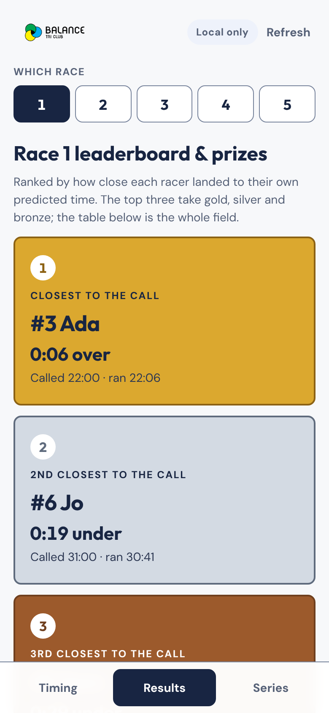

The top three get automatic medal cards:

| Prize | Who gets it |
|---|---|
| Closest to the call | Smallest gap (gold) |
| 2nd closest | Second-smallest gap (silver) |
| 3rd closest | Third-smallest gap (bronze) |
| Furthest from the call | Largest gap. Shows once more than three racers are home. Dark navy, not a medal. |

Scroll down for the full table.

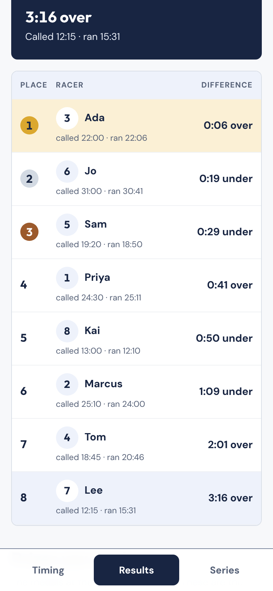

**Hand out your own prizes.** Best hat. Best excuse. Whatever the day throws up.

1. Under **Make one up**, type the prize name.
2. Pick the racer in **Give it to**.
3. Tap **Award it**.

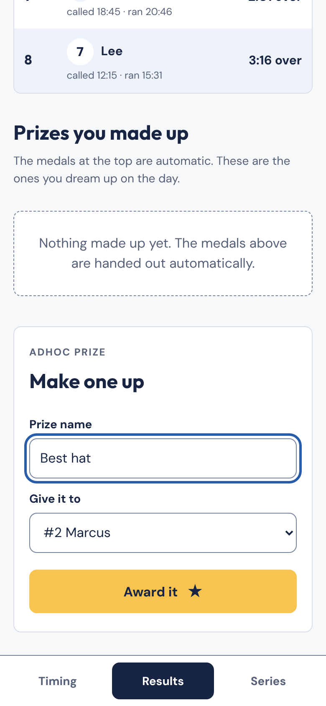

Per-race prizes do not depend on the series. Someone who turns up once can win every prize on the day.

### Series

Tap **Series** to see standings across all five races.

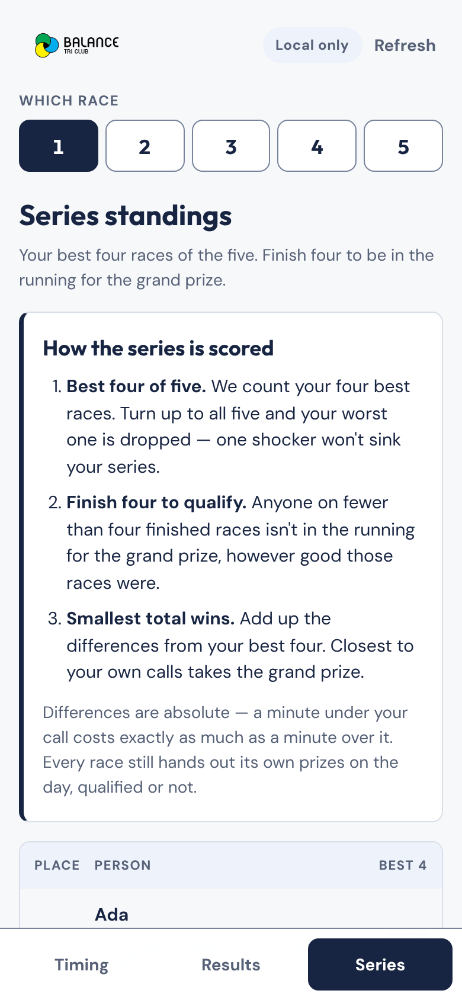

The scoring is printed on the page, so nobody has to guess:

1. **Best four of five.** Your four best races count. Race all five and your worst one drops. It still shows in the table, struck through.
2. **Finish four to qualify.** Anyone on fewer than four sits below the qualifiers, ranked `—`.
3. **Smallest total wins.** Add up the gaps from your four best races.

A minute under your call costs the same as a minute over.

Two series prizes:

| Prize | Who gets it |
|---|---|
| Grand prize | Smallest best-four total, among people who finished at least four races |
| Most consistent | Lowest average gap, across at least three completed races |

The two are separate. Someone with three near-perfect races can win Most consistent without qualifying for the grand prize.

### Timing tips

- **Time from one device.** Each time is "finish minus wave start", both read from the device clock. Two phones a few seconds apart produce times a few seconds apart. Start each wave and stop its racers on the same phone, or on phones whose clocks agree.
- **Lost signal is fine.** Actions taken offline wait in a queue. They send when the signal returns. No time gets lost.
- **Refresh** pulls the latest from the sheet. The app also checks on its own every few seconds.

### Quick checklist for race day

- [ ] Sheet connected. Pill says **Synced**.
- [ ] Race number set on race control.
- [ ] Sign-up phone open on the sign-up page.
- [ ] One phone chosen for timing.
- [ ] Wave 1 started at the gun. Other waves started at **Start now**.
- [ ] Every racer finished, or marked DNS or DNF.
- [ ] Results checked. Adhoc prizes awarded.
